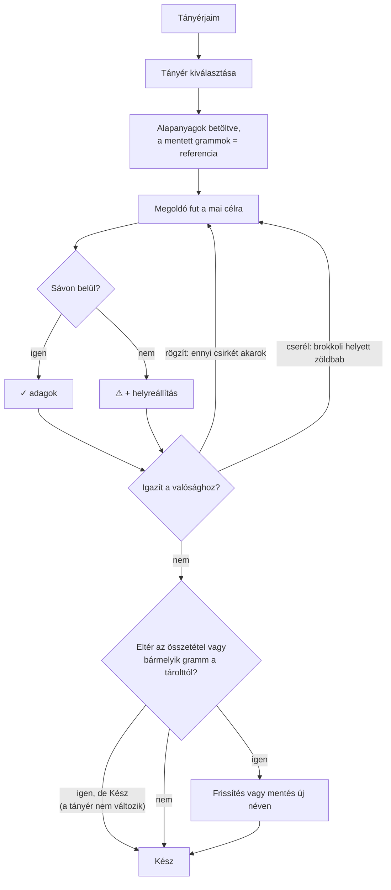
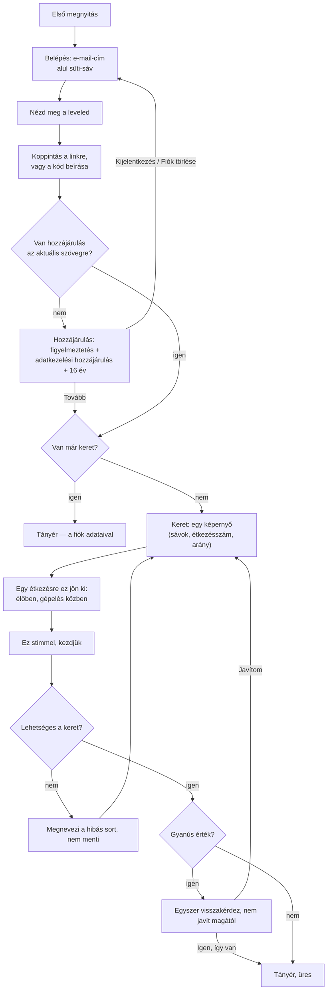

# Ketara — Folyamatok és képernyők v0.8

*Kísérőanyag a PRD v1.1-hez. Minden döntés onnan származik.*
*Utolsó frissítés: 2026-10-24*

---

## Kiindulás

Öt dolog rögzíti ezt a tervet:

1. **Az étkezési cél állandó** (napi sáv ÷ étkezésszám, minden étkezésre azonos
   zsír–fehérje aránnyal). Nincs étkezésválasztó.
2. **A megoldó a referenciatányérhoz keresi a legközelebbi megoldást** (relatív
   eltérésben); ha nincs korábbi használat, az alapanyag egyedi felülírásához, végül a
   kategória alapértékéhez.
3. **A ⚠ állapot gyakoribb lesz, mint a ✓.** Rögzítéssel különösen. Ez tehát nem
   hibaképernyő, hanem a termék fő állapota.

4. **A grammok nem ismétlődnek, csak a készlet.** A megoldó minden étkezésnél lefut.
   A **Tányér a főképernyő**; a Tányérjaim nem előzmény, hanem **kiindulópont-tár**.
   Egy mentett tányér megnyitása nem olvasás, hanem újraszámolás.

5. **Nyilvános weboldal, fiókkal** (PRD 6.6). Belépés e-mailes linkkel vagy kóddal, egyszer
   eszközönként; utána a konyhában a fiók észrevétlen: hálózat nélkül is működik, a
   szinkron a háttérben fut. A fiókbeállítások a Keret alján vannak, nem külön képernyőn.

---

## 1. Folyamat — Új tányér összeállítása

Ez a termék fő útja. Ott áll a konyhában, előtte van, ami van.


**A `Kész` ✓ és ⚠ esetén is ott van, és nem opcionális.** Ő dönti el, mit eszik meg, nem a
szoftver. Ha elfogadja a 6,6 g túllépést, az app nem áll az útjába — csak egyszer,
világosan megmondja, mi a helyzet. A `Kész` név nélküli: tányért nem ment, csak megjegyzi a
grammokat, hogy legközelebb azokból induljon (PRD 6.5). A korábbi `Mentés így` gomb ebbe
olvadt.

**Rögzítés nélküli ⚠** (PRD 6.4): ha az arány sérül, a zsiradékot ajánlja; különben a
grammban legnagyobb eltérés dönti el, „kevés" vagy „sok". A segítő kategóriát kategóriánként
egy, a gondozó által kijelölt mintaalapanyaggal próbálja ki. Ha egyik sem segít, a zsákutca
szövege jön (7. fejezet).

---

## 2. Folyamat — Ismétlődő étkezés



**A megoldó itt is lefut.** A mentett tányér nem kész válasz — a grammok soha nem
ismétlődnek pontosan, mert a valóság minden nap más. A tárolt mennyiségek csak azt mondják
meg a megoldónak, milyen összetételt szeret. A mentett tányér rögzítés nélkül nyílik: a
tegnapi rögzítés tegnapi döntés volt. (Más az **aktuális tányér**: ha főzés közben bezárja
az appot, újranyitáskor ugyanaz vár rá, a rögzítésekkel együtt. Ez csak az eszközön van, és
a `Kész` vagy egy új tányér törli — PRD 6.6.)

Egy megváltozott mentett tányérnál a `Kész` sem kötelez frissítésre: a grammok „legutóbb
használt" értékek lesznek, a tányér változatlan marad.

Ez egyben megoldja a korábbi „elavult mentett tányér" veszélyt is: mivel minden megnyitás
újraszámol, egy javított keret (elgépelés) vagy módosított tápérték automatikusan átüt a
régi tányérokon. Külön ellenőrzés nem kell.

---

## 3. Folyamat — Első indítás



**Belépés.** Egy mező, egy gomb. Jelszó nincs. Az e-mailben egy link és egy 6 jegyű kód
jön. A kettő **egy belépési token**: bármelyik felhasználása mindkettőt érvényteleníti,
15 percig érvényes, és 5 hibás kód után új kell. A link azt a böngészőt lépteti be, amelyben
megnyílik. Ha máshol nyílt meg (laptop, a levelezőalkalmazás saját böngészője), a kódot a
várakozó képernyőn lehet beírni. Ha lejárt vagy már felhasználták, a képernyő megmondja, és
egy gombbal újat küld. Egy eszközön a belépés 1 évig megmarad, és minden használattal
megújul: a konyhában gyakorlatilag soha nem kell újra belépni.

**Hozzájárulás.** Akkor jelenik meg, ha a fiókhoz nincs rögzített hozzájárulás az aktuális
szövegverzióhoz — nem az számít, hogy új-e a fiók vagy az eszköz: fiókonként és
szövegverziónként egyszer kell. Ha valaki a hozzájárulás előtt bezárja az oldalt, a
következő megnyitáskor újra ez jön. Ha a jogi szöveg változik, újra megjelenik.
Három dolog egy képernyőn: a figyelmeztetés („A Ketara számol, nem tanácsot ad."), a
kifejezett hozzájárulás az étrendi adatok kezeléséhez (PRD 6.6), az adatvédelmi
tájékoztató linkjével, és a nyilatkozat, hogy elmúlt 16 éves. Hozzájárulás nélkül nincs
tovább: új fióknál addig étrendi adat sehova nem kerül; meglévő fióknál (új szövegverzió)
az adat zárolva van — megmarad, de nem látszik és nem szinkronizál. Aki nem fogadja el,
nem ragad be: a képernyő alján `Kijelentkezés` és `Fiók törlése` is van.

**Süti-sáv.** Az első megnyitáskor alul, a Belépés fölött. Két egyenrangú gomb:
`Elfogadom` és `Csak a szükségesek`. A választás a Keret alján bármikor módosítható. Az
analitika csak elfogadás után indul (PRD 6.8).

**Keret.** Egyetlen képernyő (UX 8.2): a számított étkezési cél gépelés közben élőben
frissül, a gomb `Ez stimmel, kezdjük`. Gombnyomáskor jön az ellenőrzés: logikai hiba esetén
megnevezi a sort és nem menti; gyanús értéknél egyszer visszakérdez (`Igen, így van` /
`Javítom`).

A `H` lépés a legfontosabb az egész beállításban: **mutasd meg neki a kiszámolt étkezési
célt, mielőtt továbbenged.** Négy éve fejből tudja, mennyi jön ki egy étkezésre. Ha a mi
számunk más, azonnal látja, és rögtön kiderül, hogy félreértettük a papírt.

---

## 4. Képernyőlista

| # | Képernyő | Egy mondatban |
|---|---|---|
| 1 | **Tányér** | Itt történik minden: alapanyagok, adagok, eredmény, egy képernyőn. |
| 2 | **Alapanyag-választó** | Alsó lap: keresés, kategóriák, legutóbbiak. |
| 3 | **Saját alapanyag** | Név, kategória, 100 g tápérték. |
| 4 | **Tányérjaim** | Kiindulópontok: mentett alapanyag-kombinációk, megnyitáskor újraszámolva. |
| 5 | **Keret** | A dietetikus számai, a belőlük számolt étkezési cél, alul a fiók. |

Öt képernyő. Ha ennél több lesz, valamit rosszul csinálunk.

A **Belépés** és a **Hozzájárulás** nem számít bele: a Belépés eszközönként egyszer
látszik, a Hozzájárulás fiókonként és szövegverziónként egyszer; a konyhai használat része
egyik sem. A fiókbeállítások a Keret alján vannak (6.4), mert az is
ritkán nyitott képernyő.

---

## 5. Tányér — a fő képernyő állapotai

### 5.1 Üres

```
┌─ Tányér ─────────────────────────┐
│ Étkezési cél                  ⚙ │
│ CH 5–10 · Fe 20–25 · Zs 45–70   │
│ ──────────────────────────────── │
│                                  │
│   Még nincs alapanyag.           │
│   Válassz legalább hármat,       │
│   és kiszámolom az adagokat.     │
│                                  │
│                                  │
│ [ + Alapanyag                  ] │
│ [ Tányérjaim                   ] │
└──────────────────────────────────┘
```

A nagy `Tányérjaim` gomb **csak az üres tányéron** van. Máskor a Tányérjaim a fejléc bal
oldalán érhető el, a cél-sáv a jobb oldalán (UX 3).

### 5.2 Alulhatározott (1–2 alapanyag)

```
┌─ Tányér ─────────────────────────┐
│ CH 5–10 · Fe 20–25 · Zs 45–70   │
│ ──────────────────────────────── │
│ Tojás                   — g      │
│ Brokkoli                — g      │
│                                  │
│ [ + Alapanyag ]                  │
│ ──────────────────────────────── │
│ Még egy alapanyag kell a         │
│ számoláshoz.                     │
└──────────────────────────────────┘
```

A `— g` fontos: **a sorok már ott vannak, csak a szám hiányzik.** Így látszik, hogy nem
elromlott valami, hanem még nincs kész.

### 5.3 Sávon belül

```
┌─ Tányér ─────────────────────────┐
│ CH 5–10 · Fe 20–25 · Zs 45–70   │
│ ──────────────────────────────── │
│ Tojás       137 g (nyersen)   ◯  │
│ Brokkoli    100 g (nyersen)   ◯  │
│ Olaj         31 g (nyersen)   ◯  │
│                                  │
│ [ + Alapanyag ]                  │
│ ──────────────────────────────── │
│ ✓ Minden érték a sávon belül.    │
│                                  │
│ [ Tányér mentése               ] │
│ [ Kész                         ] │
└──────────────────────────────────┘
```

Ha a Keretben van kcal-sáv, és a makrók szerinti megoldás abból kilóg, a ✓ alatt egy sor
jelenik meg: *„Kalória: 40 kcal-lal a sáv fölött."* Az állapot ✓ marad.

**Mentett tányérból indulva** a mentés helyén két gomb áll, ha az eredmény eltér a
tároltaktól:

```
│ ✓ Minden érték a sávon belül.    │
│                                  │
│ [ Csütörtöki csirkés frissítése ]│
│ [ Mentés új néven              ] │
│ [ Kész                         ] │
```

A két mentőgomb akkor jelenik meg, ha **a sorok halmaza** (csere, hozzáadás, törlés) **vagy
bármelyik kiírt gramm** eltér a tárolttól; a frissítés az összetételt is felülírja. Ha nem
tér el, nincs mentőgomb, csak a `Kész`. A horgony így csak akkor mozdul, ha ő mozdítja. Nem
sodródik el csendben, és nem is ragad be véglegesen egy elavult összetételbe.

**`Kész`** mindig ott van: „ezt eszem". Név nélküli, tányért nem ment; a kiírt grammok
lesznek az alapanyagok „legutóbb használt" mennyiségei (a 0 g-os sor kivételével). Utána rövid
visszajelzés: *„Megjegyeztem. Legközelebb ebből indulok."*

**Mentéskor a 0 g-os sor kimarad** a tányérból (PRD 6.5); a mentés lapja ezt kiírja:
*„Kimarad a tányérból, mert 0 g: {Alapanyag}."*

A ◯ minden soron ott van, halványan — ez a rögzítés gombja (rögzítve 🔒; UX 4.2). Nem külön menüben,
nem hosszú nyomásra: **látható és egy koppintás.** Ez a funkció, amit ő maga kért.

**Soron belüli műveletek** (koppintás a néven): `Rögzítés` · `Csere` · `Törlés`.
A csere ugyanannak a kategóriának a tagjait kínálja (a tányéron már szereplők nélkül), és
**leveszi a rögzítést** —
180 g brokkolit rögzíteni nem ugyanaz, mint 180 g zöldbabot.

```
┌─ Csere: Brokkoli ────────── ✕ ──┐
│ Zöldség                          │
│  Zöldbab · Karfiol · Cukkini     │
│  Spenót · Paprika · Sárgarépa    │
│ ──────────────────────────────── │
│ [ Másik kategóriából…          ] │
└──────────────────────────────────┘
```

A **`Másik kategóriából…`** nem csere, hanem törlés + hozzáadás egy mozdulatban: a sor (a
rögzítésével együtt) kikerül, és a választó minden kategóriával megnyílik. Az új alapanyag a
saját referenciájáról indul, nem a régi grammjáról.

### 5.4 Legközelebbi elérhető (⚠) — rögzítés az ok

```
┌─ Tányér ─────────────────────────┐
│ CH 5–10 · Fe 20–25 · Zs 45–70   │
│ ──────────────────────────────── │
│ Tojás       240 g (nyersen)   🔒 │
│ Brokkoli     48 g (nyersen)   ◯  │
│ Olaj         39 g (nyersen)   ◯  │
│                                  │
│ [ + Alapanyag ]                  │
│ ──────────────────────────────── │
│ ⚠ Fehérje: 6,6 g-mal a sáv       │
│ fölött.                          │
│                                  │
│ Rögzítve: Tojás 240 g (nyersen). │
│ Ez önmagában 30,2 g fehérjét hoz.│
│ A sáv teteje 25 g.               │
│                                  │
│ Ha feloldod: Tojás               │
│ 137 g tojás · 100 g brokkoli ·   │
│ 31 g olaj (nyersen) → minden     │
│ érték a sávon belül.             │
│                                  │
│ [ Tojás feloldása ]  [+ Alapanyag]│
│ [ Tányér mentése               ] │
│ [ Kész                         ] │
└──────────────────────────────────┘
```

Négy dolog, ami itt szándékos:

- **A 🔒 (rögzített) más, mint a ◯ (rögzíthető)**, alakban, színben és szövegben is
  (UX 4.2). Ránézésre látszik, mi fix.
- **Az előzetes megmondja, hová vezet a feloldás** — itt a sávba; ha az sem elég, azt
  mondja ki. Enélkül a felhasználó vaktában
  nyomkod, és pontosan azt csinálja, amit ma is: próbálgat 10 percig.
- **A `Kész` ott van.** Nem rejtjük el, nem kérdezünk rá kétszer.
- **A brokkoli 48 g-ra csökken.** A megoldó ⚠ esetén előbb az arányt tartja, aztán a
  kilógást csökkenti (PRD 6.3): a brokkoli is hoz fehérjét, ezért addig megy le, amíg a
  CH-sáv alja engedi. Az olaj annyi, amennyit az arány kér.

A ⚠ sorai rögzített sorrendben jönnek, mindegyik egyszer: arány → a kilógó makrók (a
grammban nagyobb elöl) → 0 g-ra szorult sor → kerekítés → kcal (PRD 6.4). Az első a
címsor; utána az ok, az előzetes, a gombok.

### 5.5 Minden alapanyag rögzítve

```
│ Tojás       160 g (nyersen)   🔒 │
│ Brokkoli    150 g (nyersen)   🔒 │
│ Olaj         20 g (nyersen)   🔒 │
│ ──────────────────────────────── │
│ ⚠ Zsír–fehérje arány: 1,5 : 1,   │
│ a minimum 2 : 1.                 │
│ Zsír: 8,4 g-mal a sáv alatt.     │
│ Szénhidrát: 1,6 g-mal a sáv      │
│ fölött.                          │
│ Nincs mit kiszámolni — minden    │
│ adag rögzítve.                   │
│                                  │
│ Ha feloldod: Olaj                │
│ 33 g olaj (nyersen) → Szénhidrát:│
│ 1,6 g-mal a sáv fölött.          │
│                                  │
│ Ha feloldod mindet:              │
│ 137 g tojás · 100 g brokkoli ·   │
│ 31 g olaj (nyersen) → minden     │
│ érték a sávon belül.             │
│                                  │
│ [ Olaj feloldása ]               │
│ [ Rögzítések feloldása         ] │
│ [ Tányér mentése               ] │
│ [ Kész                         ] │
```

Ez nem hibaállapot: **kiértékelés.** „Ezt akarom enni — jó lesz?" Legitim kérdés, és a
termék válaszol rá.

A kiértékelésnek is van ✓/⚠ címsora, és alatta ugyanúgy ott a mentés helye és a `Kész`
(PRD 6.2). A makrósor (UX 4.4) itt is látszik.

**Melyik feloldást ajánlja:** a megoldó egyenként kipróbálja mindhárom feloldást. Egyik
egyedi feloldás sem hoz sávba; az olajé csökkenti legjobban a kilógást.
Ezért kerül mellé a „Rögzítések feloldása" is — ez minden rögzítést felold, az eredményét
ugyanígy előre mutatva („Ha feloldod mindet: …"), és csak akkor jelenik meg, ha egyetlen
feloldás sem elég. Ha valamelyik egyedül sávba hozna, csak az az egy gomb állna ott.

---

## 6. A többi képernyő

### 6.1 Alapanyag-választó (alsó lap)

```
┌─ Alapanyag ──────────────── ✕ ──┐
│ [🔍 keresés                    ] │
│ ──────────────────────────────── │
│ Legutóbb használt                │
│  Csirkemell · Tojás · Brokkoli   │
│  Cukkini · Olívaolaj · Vaj       │
│ ──────────────────────────────── │
│ Fehérjeforrás      >             │
│ Gabonaköret        >             │
│ Zöldség            >             │
│ Zsiradék           >             │
│ Gyümölcs           >             │
│ Tejtermék          >             │
│ ──────────────────────────────── │
│ [ + Saját alapanyag            ] │
└──────────────────────────────────┘
```

**Állapotok:** üres kereső (legutóbbiak + kategóriák) · találatok · nincs találat.

A lap több alapanyagot is felvesz egy menetben; alul a gomb: `Hozzáadás (3)` (UX 5). A
„Legutóbb használt" a `Kész` és a mentések alapján töltődik. Ha a tányéron már 8 alapanyag
van, többet nem enged: *„Egy tányéron legfeljebb 8 alapanyag lehet."*

Nincs találat esetén: *„Nincs ilyen a listában. Felviszed sajátként?"* — és a beírt szöveg
átkerül a névmezőbe. Ne kelljen újra begépelni.

### 6.2 Saját alapanyag

```
┌─ Saját alapanyag ──────── ✕ ────┐
│ Név                              │
│ [ Anyu túrója                  ] │
│                                  │
│ Kategória                        │
│ Fehérjeforrás · Gabonaköret      │
│ Zöldség · Zsiradék · Gyümölcs    │
│ [Tejtermék]                      │
│                                  │
│ 100 grammban, nyersen            │
│ Szénhidrát  [  4 ] g             │
│ Fehérje     [ 13 ] g             │
│ Zsír        [  1 ] g             │
│                                  │
│ [ Mentés                       ] │
└──────────────────────────────────┘
```

A kategória választógombsor (hat elem, egy kijelölt; UX 6), nem legördülő lista.

**A kategória kötelező, és ez nem adminisztráció:** ebből jön az alapérték, amihez a
megoldó horgonyoz az első használatnál. Ha nincs kategória, az első javaslat vaktában
születik.

**Ellenőrzés:** CH + fehérje + zsír ≤ 100 g. Ha nem, a szöveg: *„100 grammban ennyi nem
fér el. Nézd meg a csomagolást."* Nem „érvénytelen bevitel".

**Szerkesztés és törlés.** A saját alapanyag a választóban a „…" menüből szerkeszthető
(ugyanez a lap, kitöltve) és törölhető. Ha mentett tányér használja, törlés előtt alsó lap:
*„Anyu túrója — ezekben a tányérokban szerepel: Reggeli túrós. Törléskor kikerül
belőlük."* — `Törlöm` / `Mégse`. Az így üressé váló tányér is törlődik; a 3-nál kevesebb
sorral maradó megmarad, és hiányos állapotban nyílik (5.2).

### 6.3 Tányérjaim

```
┌─ Tányérjaim ─────────────────────┐
│ Csütörtöki csirkés               │
│ csirkemell · cukkini · vaj       │
│                                  │
│ Reggeli túrós                    │
│ túró · dió · tejszín             │
│                                  │
│ Tojásos vacsora                  │
│ tojás · brokkoli · olaj          │
│                                  │
│ [ + Új tányér                  ] │
└──────────────────────────────────┘
```

**Üres állapot — az első nap:**
*„Még nincs mentett tányérod. Számolj ki egyet, és mentsd el — legközelebb innen indulhatsz."*

Ez az üres állapot fontos: **megmondja, mi lesz a jutalom.** A termék az első héten
gyűjt, utána fizet.

**Megnyitáskor:** a tányér nem kész számokkal nyílik meg, hanem betölti az alapanyagokat,
és **újraszámol**. A mentett grammok a horgony, nem a válasz. Ha a felhasználó ezt nem
látja, azt fogja hinni, hogy elromlott valami — ezért a fejlécben egy sor:
*„{Tányér neve} — a mai célra újraszámolva."* A tányér rögzítés nélkül nyílik.

**Átnevezés és törlés** a sor „…" menüjéből. A tányérnév egyedi: foglalt névnél a
névmező alatt *„Már van ilyen nevű tányér."*, és a mentés addig nem aktív.

### 6.4 Keret

```
┌─ Keret ──────────────────────────┐
│ Napi sávok                       │
│ Szénhidrát  [ 15]–[ 30] g        │
│ Fehérje     [ 60]–[ 75] g        │
│ Zsír        [135]–[210] g        │
│ Kalória     [    ]–[    ] kcal   │
│                                  │
│ Étkezések száma      [ 3 ]       │
│ Zsír : fehérje, min. [ 2 ] : 1   │
│ ──────────────────────────────── │
│ Egy étkezésre ez jön ki:         │
│ CH 5–10 · Fe 20–25 · Zs 45–70    │
│                                  │
│ [ Mentés                       ] │
│ ──────────────────────────────── │
│ A Ketara számol, nem tanácsot ad.│
│ Nem helyettesíti a dietetikust.  │
│ ──────────────────────────────── │
│ Fiók                             │
│ anna@pelda.hu                    │
│ Minden eszközödön szinkronban.   │
│ Sütik: csak a szükségesek     >  │
│ Adatvédelmi tájékoztató       >  │
│ Adataim letöltése                │
│ Kijelentkezés                    │
│ Kijelentkezés minden eszközről   │
│ Fiók törlése                     │
│ A hozzájárulás visszavonása a    │
│ fiók törlésével történik.        │
└──────────────────────────────────┘
```

**Fiók blokk.** A Keret alatt, a Mentés gomb után, hogy a beállítás útjában ne legyen. A
szinkron állapota egy sor: „Minden eszközödön szinkronban." vagy, ha hálózat nélkül van
el nem küldött változás: „Nincs kapcsolat. A változásaid megvannak, és elküldöm őket,
amint lesz." A Tányéron a szinkron nem jelenik meg: a konyhában nem kell tudni róla.

**Adataim letöltése:** a fiók teljes tartalma egy JSON fájlban (PRD 6.6), az eszközön
tartott aktuális tányérral együtt.

**Kijelentkezés** (és **Kijelentkezés minden eszközről**): előbb szinkronizál. Ha nincs
kapcsolat, és van el nem küldött változás, egyszer figyelmeztet: *„3 változás még nincs
elküldve. Ha most kilépsz, elvesznek."* — `Kilépek` / `Mégse`. Különben megerősítés nélkül
kilép.

**Fiók törlése** a fiókhoz kötött egyetlen megerősítő kérdés visszavonás helyett, mert nem
vonható vissza: alsó lap — a 7. fejezet „Fiók törlése" szövege — `Végleg törlöm` / `Mégse`.
Utána minden eszköz kijelentkezik; egy offline eszköz a következő kapcsolódáskor törli a
helyi adatot, és nem tölt fel semmit. A hozzájárulás visszavonása ugyanez az út.

Az alsó blokk a lényeg. **Nem beviteli mező, hanem visszajelzés** — ő négy éve tudja
fejből, mennyi jön ki egy étkezésre, és itt azonnal látja, hogy jól értettük-e a papírt.

Az arány mezőben csak a zsír oldala írható, alapértéke 2. Minden szöveg ezt az értéket
írja ki.

**Lehetetlen keret:** ha egy alsó határ nagyobb a felsőnél, vagy a zsírsáv teteje kisebb,
mint {min} × a fehérjesáv alja, a termék nem menti, és megnevezi a sort: *„A zsírsáv teteje
kisebb, mint amit az arány a fehérjéhez kér. Így egyetlen tányér sem jönne ki."*

**Gyanús érték:** a termék nem javítja csendben, és nem is tiltja meg. Visszakérdez
egyszer — alacsony értéknél: *„Ez alacsonyabb, mint amit dietetikusok általában adnak.
Biztosan így van a papíron?"*; szűk sávnál: *„Ez a sáv nagyon szűk, kevés tányér fog
beleférni. Biztosan így van a papíron?"* — és ha igen, elfogadja. A küszöbök (a kcal-sáv
felső határa 1200 — csak ha van kcal-sáv —, a fehérjesáv felső határa 50 g, a sávszélesség a
felső határ 10%-a) helykitöltők, a dietetikus erősíti meg őket.
Nem a mi dolgunk felülbírálni a dietetikust; a mi dolgunk észrevenni az elgépelést.

---

### 6.5 Belépés

```
┌──────────────────────────────────┐
│ Ketara                           │
│                                  │
│ Megmondja, hány grammot vegyél   │
│ abból, ami előtted van.          │
│                                  │
│ E-mail-cím                       │
│ [ anna@pelda.hu                ] │
│                                  │
│ [ Belépési link küldése        ] │
│                                  │
│ Jelszó nincs: e-mailben küldök   │
│ egy linket és egy kódot.         │
└──────────────────────────────────┘
```

**Elküldés után** ugyanez a képernyő: „Elküldtem a linket és a kódot ide: anna@pelda.hu."
+ egy 6 jegyű kódmező („Ha a link máshol nyílt meg, írd be ide a kódot.") + `Újraküldés` ·
`Másik e-mail-cím`.

### 6.6 Hozzájárulás

```
┌──────────────────────────────────┐
│ Mielőtt elkezded                 │
│                                  │
│ A Ketara számol, nem tanácsot ad.│
│ Nem helyettesíti a dietetikust:  │
│ a számokat ő adja, te írod be.   │
│                                  │
│ ☐ Hozzájárulok, hogy a Ketara    │
│   tárolja az e-mail-címemet és az│
│   étrendi adataimat (keret, saját│
│   alapanyagok, tányérok, legutóbb│
│   használt mennyiségek).         │
│   Adatvédelmi tájékoztató >      │
│ ☐ Elmúltam 16 éves.              │
│                                  │
│ [ Tovább                       ] │
│ ──────────────────────────────── │
│ Kijelentkezés · Fiók törlése     │
└──────────────────────────────────┘
```

A `Tovább` mindkét pipa nélkül nem aktív. A figyelmeztetés itt a hosszú változat, a Keret
alján a rövid (7. fejezet). A `Kijelentkezés` és a `Fiók törlése` ugyanaz, mint a Fiók
blokkban (6.4); így aki egy új szövegverziót nem fogad el, kiléphet vagy törölheti a fiókját. A hozzájárulás szövegverzióval és időponttal
mentődik.

### 6.7 Süti-sáv

```
│ ──────────────────────────────── │
│ Sütiket használok, hogy lássam,  │
│ mi működik. Étrendi adat nem     │
│ kerül bele.                      │
│ [ Elfogadom ]                    │
│ [ Csak a szükségesek ]           │
└──────────────────────────────────┘
```

## 7. Szövegek egy helyen

| Hol | Szöveg |
|---|---|
| Tányér, üres | Még nincs alapanyag. Válassz legalább hármat, és kiszámolom az adagokat. |
| Tányér, 2 alapanyag | Még egy alapanyag kell a számoláshoz. |
| Tányér, 1 alapanyag | Még két alapanyag kell a számoláshoz. |
| ✓ | Minden érték a sávon belül. |
| ✓ vagy ⚠ + kcal | Kalória: {n} kcal-lal a sáv {fölött / alatt}. |
| ⚠ általános | {Makró}: {n,n} g-mal a sáv {fölött / alatt}. |
| ⚠ rögzítés az ok, felső él | Rögzítve: {Alapanyag} {n} g (nyersen). Ez önmagában {m,m} g {makrót} hoz. A sáv teteje {k} g. |
| ⚠ rögzítés az ok, alsó él | Rögzítve: {Alapanyag} {n} g (nyersen). Mellette a {makró} legfeljebb {m,m} g lehet. A sáv alja {k} g. |
| ⚠ feloldás-előzetes, sikeres | Ha feloldod: {Alapanyag}<br>{adagok} (nyersen) → minden érték a sávon belül. |
| ⚠ feloldás-előzetes, részleges | Ha feloldod: {Alapanyag}<br>{adagok} (nyersen) → {Makró}: {n,n} g-mal a sáv {fölött / alatt}. |
| ⚠ mindet feloldva, előzetes | Ha feloldod mindet:<br>{adagok} (nyersen) → {minden érték a sávon belül / Makró: n,n g-mal a sáv fölött / alatt}. |
| ⚠ arány | Zsír–fehérje arány: {x,x} : 1, a minimum {min} : 1. |
| ⚠ 0 g | 0 g-ra szorult: {Alapanyag}. Ebben a tányérban nem fér el — cseréld vagy vedd ki. |
| ⚠ kerekítés az ok | Egész grammokra kerekítve nem fér bele a sávba. |
| ⚠ nincs rögzítés, arány vagy kevés | Kevés a {makró} — adj hozzá a {Kategória} közül. |
| ⚠ nincs rögzítés, sok | Sok a {makró} — {Alapanyag} cseréje segít. |
| ⚠ zsákutca | Ezekből az alapanyagokból nem jön ki. |
| ⚠ helyreállító gombok | {Alapanyag} feloldása · + {Kategória} · {Alapanyag} cseréje · + Alapanyag |
| Több rögzítés, egyik feloldás sem elég | Rögzítések feloldása |
| Minden rögzítve | Nincs mit kiszámolni — minden adag rögzítve. |
| Rögzített sor | rögzítve · (nyersen) |
| Sor-műveletek | Rögzítés / Feloldás · Csere · Törlés |
| Csere-választó alja | Másik kategóriából… |
| Törlés után | Törölve: {Alapanyag}. Visszavonás |
| Választó gombja | Hozzáadás ({n}) |
| Választó, 8 alapanyag | Egy tányéron legfeljebb 8 alapanyag lehet. |
| Választó ⚠-ból nyitva | A {makróhoz} ezek segítenek a legtöbbet. |
| Választó, saját | + Saját alapanyag |
| Nincs keresési találat | Nincs ilyen a listában. Felviszed sajátként? |
| Érvénytelen tápérték | 100 grammban ennyi nem fér el. Nézd meg a csomagolást. |
| Tányérjaim, üres | Még nincs mentett tányérod. Számolj ki egyet, és mentsd el — legközelebb innen indulhatsz. |
| Mentett tányér megnyitva | {Tányér neve} — a mai célra újraszámolva. |
| Mentés gombjai | Tányér mentése · Mentés új néven · Mentés |
| Mentés lap, ⚠ | {Makró}: {n,n} g-mal a sáv {fölött / alatt}. |
| Mentés lap, 0 g-os sor | Kimarad a tányérból, mert 0 g: {Alapanyag}. |
| Mentés után | Mentve: {Tányér neve} |
| Tányérjaim, nem mentett munka | A mostani tányér nincs elmentve. Lecseréled? — Lecserélem / Mégse |
| Tányérjaim, új | + Új tányér |
| Tányér törlése után | Törölve: {Tányér neve}. Visszavonás |
| Frissítés gomb | {Tányér neve} frissítése |
| Frissítés után | Frissítve. Legközelebb innen indul. |
| Kész gomb | Kész |
| Kész után | Megjegyeztem. Legközelebb ebből indulok. |
| Foglalt tányérnév | Már van ilyen nevű tányér. |
| Saját alapanyag törlése, tányérban használt | {Alapanyag} — ezekben a tányérokban szerepel: {tányérok}. Törléskor kikerül belőlük. — Törlöm / Mégse |
| Csere rögzített soron | A rögzítés lekerült, mert az alapanyag változott. |
| Keret, bevezető (első indítás) | Írd be a dietetikusod számait. Csak egyszer kell. |
| Keret, kcal-sáv fölött | Ha a papíron van. |
| Keret, élő cél | Egy étkezésre ez jön ki: |
| Keret gombja | Ez stimmel, kezdjük (első indításkor) · Mentés (később) |
| Keret, gyanús érték gombjai | Igen, így van · Javítom |
| Keret, gyanúsan alacsony | Ez alacsonyabb, mint amit dietetikusok általában adnak. Biztosan így van a papíron? |
| Keret, gyanúsan szűk | Ez a sáv nagyon szűk, kevés tányér fog beleférni. Biztosan így van a papíron? |
| Keret, lehetetlen (alsó > felső) | Az alsó határ nagyobb a felsőnél. Nézd meg a papírt. |
| Keret, lehetetlen (arány) | A zsírsáv teteje kisebb, mint amit az arány a fehérjéhez kér. Így egyetlen tányér sem jönne ki. |
| Belépés, ígéret | Megmondja, hány grammot vegyél abból, ami előtted van. |
| Belépés, magyarázat | Jelszó nincs: e-mailben küldök egy linket és egy kódot. |
| Belépés gombjai | Belépési link küldése · Újraküldés · Másik e-mail-cím |
| Link elküldve | Elküldtem a linket és a kódot ide: {e-mail}. |
| Kódmező | Ha a link máshol nyílt meg, írd be ide a kódot. |
| Link vagy kód lejárt / felhasznált | Ez a link vagy kód már nem érvényes. Küldök egy újat. |
| Hibás kód | Ez a kód nem jó. Nézd meg újra a leveled. |
| Hozzájárulás, cím | Mielőtt elkezded |
| Figyelmeztetés, hosszú (Hozzájárulás) | A Ketara számol, nem tanácsot ad. Nem helyettesíti a dietetikust: a számokat ő adja, te írod be. |
| Figyelmeztetés, rövid (Keret alja) | A Ketara számol, nem tanácsot ad. Nem helyettesíti a dietetikust. |
| Hozzájárulás gombjai | Tovább · Kijelentkezés · Fiók törlése |
| Hozzájárulás | Hozzájárulok, hogy a Ketara tárolja az e-mail-címemet és az étrendi adataimat (keret, saját alapanyagok, tányérok, legutóbb használt mennyiségek). |
| Korhatár | Elmúltam 16 éves. |
| Süti-sáv | Sütiket használok, hogy lássam, mi működik. Étrendi adat nem kerül bele. |
| Süti-sáv gombjai | Elfogadom · Csak a szükségesek |
| Fiók blokk, sütik | Sütik: {csak a szükségesek / elfogadva} |
| Fiók blokk, tájékoztató | Adatvédelmi tájékoztató |
| Szinkron rendben | Minden eszközödön szinkronban. |
| Szinkron, nincs kapcsolat | Nincs kapcsolat. A változásaid megvannak, és elküldöm őket, amint lesz. |
| Kijelentkezés | Kijelentkezés |
| Kijelentkezés, offline, el nem küldött változással | {N} változás még nincs elküldve. Ha most kilépsz, elvesznek. — Kilépek / Mégse |
| Fiók törlése | Minden adatod törlődik: az e-mail-címed, a keret, a saját alapanyagaid, a tányérjaid és a legutóbb használt mennyiségeid, minden eszközödön. Ez nem vonható vissza. — Végleg törlöm / Mégse |
| Hozzájárulás visszavonása | A hozzájárulás visszavonása a fiók törlésével történik. |
| Kijelentkezés mindenhol | Kijelentkezés minden eszközről |
| Adatletöltés | Adataim letöltése |
| Inaktív fiók, értesítő e-mail | Két éve nem használtad a Ketarát. Ha 30 napon belül nem nyitod meg, a fiókod és minden adatod törlődik. |


Minden szöveg tegező, kijelentő, és **megmondja a következő lépést.** Nincs „Hiba
történt", nincs „Érvénytelen".

**Nevek a sablonokban.** Alapanyag- és tányérnév (lehet saját, bármilyen betűvel kezdődő)
nem kap névelőt és ragot: kettőspont után, gondolatjel előtt vagy birtokos szerkezetben
áll („0 g-ra szorult: Olaj.", „Brokkoli cseréje segít."). A {makró} és a {Kategória} zárt
lista, mind mássalhangzóval kezdődik, így az „a" névelő és a rag (fehérjét, zsírhoz)
mindig helyes. A célértékek egy tizedessel jelennek meg, egész számnál tizedes nélkül
(„23,3", „20").

---

## 8. Amit ez a terv még nem old meg

- **Napközbeni eltérés** — ha egy étkezésnél kilépett a sávból, a következőnél ezt nem
  tudja beszámítani. Tudatos: a napkövetés out of scope.
- **Az adatvédelmi tájékoztató és a figyelmeztetés végleges szövege** — a fenti mondatok
  helykitöltők, amíg szakértő át nem nézi őket (PRD 8.1/2).
